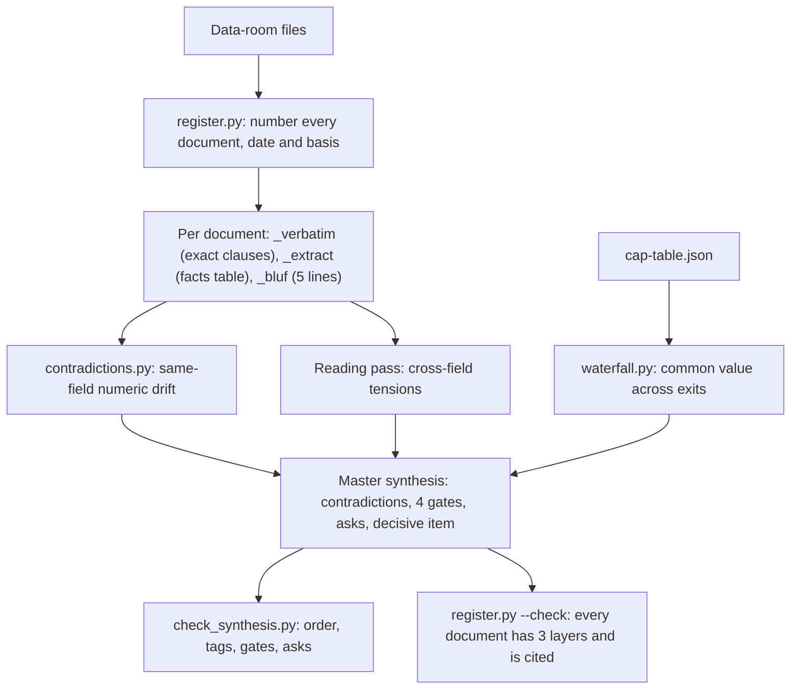

# vc-diligence-harness

A Claude skill plus a small python3 harness that turns a venture data room into a decision: contradictions first, four gates, numbered asks, and one decisive open item.

## The problem

I built this because data-room reviews fail in a predictable way. People read the deck first, absorb the story, then skim the contracts for confirmation. The numbers that decide price often disagree across documents (a purchase price the charter halves, a deck ARR the company's own schedule does not support), and those gaps are easy to miss when you read for narrative. I wanted a pipeline that finds contradictions before anyone writes a paragraph, makes every figure traceable to a clause, and states the recommendation as gates instead of a yes.

## How it works



The skill (`skills/vc-diligence/SKILL.md`) is the procedure a model follows. It registers every document before reading any for meaning, then writes three files per document: the exact text of the clauses that matter, a facts table with section references, and a five-line bottom line. That is the evidence layer.

The decision layer is the master synthesis, in a fixed order. Cross-document contradictions come first, ranked CRITICAL, HIGH, MEDIUM, each with both figures and their sources, why it matters to price, a read and an ask. Then four gates: structure and direct access (the ROFR clock, board transfer veto, joinder, information rights), unit economics (core ARR, retention, the cohort left out of the metrics, AI inference cost), valuation (409A, headline vs effective price, preference stack, common waterfall), and exit path. Then consolidated asks, then one line naming the decisive open item.

The harness does the parts a machine should do: build the register, compare numbers across extracts, run the waterfall, and lint the synthesis for structure. Judgment stays in the synthesis, marked as such.

## Quickstart

Python 3.8 or later, standard library only.

```
git clone https://github.com/gkmr/vc-diligence-harness
cd vc-diligence-harness

# the three planted contradictions in the synthetic data room
python3 harness/contradictions.py examples/larchwick-secondary/data-room --verbose

# what the block is worth to common across exit values
python3 harness/waterfall.py examples/larchwick-secondary/cap-table.json --block-shares 600000 --price-paid 4.50

# the quality gates on the expected synthesis
python3 harness/check_synthesis.py examples/larchwick-secondary/expected/master-synthesis.md --data-room examples/larchwick-secondary/data-room
python3 harness/register.py examples/larchwick-secondary/data-room --synthesis examples/larchwick-secondary/expected/master-synthesis.md --check

# all tests
python3 -m unittest discover -s tests -v
```

To use the skill with Claude Code, copy `skills/vc-diligence/` into your skills folder (for example `~/.claude/skills/`), keep this repo's `harness/` on disk, and put the deal under `deals/<name>/data-room/`, which `.gitignore` keeps out of git. Then ask for diligence on that folder.

## How it is verified

- **54 unittest tests**, no network, under a second to run.
- **Planted answers.** The example data room has three same-field contradictions and two near-misses inside the 1% tolerance. The test asserts the tool finds exactly those three, with the right values, sources and severities, and that the seven other shared fields agree.
- **Waterfall math.** Hand-checked cases: an exit below or equal to the $33.7M stack gives common $0; a $100M exit gives $3.94 per share (Series B keeps its preference, the rest convert); a $500M exit gives exit divided by 22,000,000. Over 121 exit values from $0 to $600M, money is conserved, common value never falls as the exit rises, and no series can do better by flipping its conversion choice. At every exit the result is checked against a brute-force search over all 8 conversion sets.
- **Golden files.** Each CLI output must match its file in `examples/larchwick-secondary/expected/` byte for byte, so any change that moves a number shows up as a failing test.
- **Drift between the synthesis and the tools.** The synthesis must have one "Found by: contradictions.py" block per tool finding, with the same spread, and its waterfall table rows must be the tool's printed rows, not hand-typed.
- **The lint is tested on broken copies.** Eleven mutations of the expected synthesis (narrative before contradictions, a missing Read line, an untagged figure, a table without a caption, a tag for a document that does not exist, and others) must each be caught. One of these found a real gap during development: a tagged bullet below a table was counting as its caption.
- Before publishing, the repo is run through a leak scanner for names, ids and paths: 0 hits.

## What a reviewer should look at

1. `examples/larchwick-secondary/expected/master-synthesis.md`. The output. A three-minute read: five contradictions, four gates with a status each, 17 asks, one decisive line.
2. `examples/larchwick-secondary/data-room/05-certificate-of-incorporation_verbatim.md` next to `02-series-b-spa_verbatim.md`. Follow one planted contradiction from exact clause, to extract row, to tool output, to C1 in the synthesis.
3. `harness/waterfall.py` (`solve`) and `tests/test_waterfall.py` (`Invariants`). The one piece of real finance math, and how it is checked.
4. `tests/test_synthesis.py` (`BrokenCopies`). How the structure of a judgment document becomes testable.
5. `skills/vc-diligence/SKILL.md`, steps 3 and 4. The line between what the machine checks and what a reader must check.

## Design decisions and tradeoffs

- **Three files per document, verbatim first.** It is slower than reading and summarizing. It buys traceability: every figure in the synthesis traces to an exact clause, and extracts cannot drift from a memory of the document.
- **Fields are named by economic quantity, not by the document's label.** A charter's "Original Issue Price" and a purchase agreement's "purchase price" are both `series_b_price_per_share`. That naming rule is what lets a simple field match find a 2x conflict. The cost is that a misnamed field is a silent miss, so the reading pass stays mandatory.
- **The tool only checks same-field numeric drift**, matched on as_of date with a relative tolerance. Cross-field tensions (a 409A value against a headline valuation, a rights threshold against a block size) are left to the reader and marked "Found by: reading". I chose a small checker with zero false positives on the example over a rules engine that would need tuning per deal.
- **Severity from spread is a triage default only.** The final severity is set by impact on price. In the example, a 409A tension found by reading ranks above a 4.5% share-count drift found by the tool.
- **Structure is linted, truth is not.** `check_synthesis.py` enforces the habits that slip under time pressure: contradictions first, a tag on every figure, a status on every gate, a decisive line. Whether the read is right stays with a person.
- **Markdown tables and JSON, no YAML, standard library only.** Runs anywhere, diffs well, and reads the same to a model and a person.

## Limitations

- The waterfall models non-participating preferences only (1x by default, other multiples allowed). No participation, caps, cumulative dividends, anti-dilution adjustments or multiple closings. Options and warrants count as exercised with strikes ignored, which slightly understates common per share. It values single exit points; it is a sanity check, not an option pricing model or a 409A.
- `contradictions.py` only sees what the extractor wrote, under the same field name. Bad extraction is a silent miss.
- The lint checks form. A wrong number with a valid tag passes.
- Reading PDFs and spreadsheets is out of scope. The skill relies on the model, or another tool, to get text out of files.
- One synthetic deal. The 1% tolerance and the 25% and 10% severity cut-offs are my defaults, not calibrated on a corpus.
- Not legal, tax or investment advice.

## Where this comes from

This is a reconstruction of a personal workflow. I used this method doing technical and unit-economics diligence for a venture firm, on secondary and SPV deals and on market memos for early-stage companies. The method is abstracted from that work and rebuilt here from scratch. Every company, document, figure and person in this repo is invented, and no real data-room content was used to build it.

## Layout

```
vc-diligence-harness/
  README.md  LICENSE  CHANGELOG.md  .gitignore
  skills/
    vc-diligence/SKILL.md          the procedure, triggers and quality gates
  templates/
    document-register.md           numbered register with basis and merged columns
    doc-verbatim.md                exact clauses, source of record
    doc-extract.md                 facts table and canonical field names
    doc-bluf.md                    five-line bottom line
    master-synthesis.md            contradictions, four gates, asks, decisive item
    thesis-memo.md                 market and thesis memo for pre-revenue deals
    asks-list.md                   sendable asks with owner and status
  harness/
    extract_format.py              reads extract files (markdown table or JSON)
    contradictions.py              same-field numeric drift across extracts
    waterfall.py                   common value under non-participating preferences
    register.py                    document register from a folder, merged check
    check_synthesis.py             structural lint for the master synthesis
  examples/larchwick-secondary/         synthetic company, Larchwick, Inc.
    README.md  deal-context.md  cap-table.json
    data-room/                     9 documents x verbatim, extract, BLUF
    expected/                      synthesis, register, tool outputs
  tests/
    test_contradictions.py  test_waterfall.py  test_register.py  test_synthesis.py
```

## License

MIT. See [LICENSE](LICENSE).
